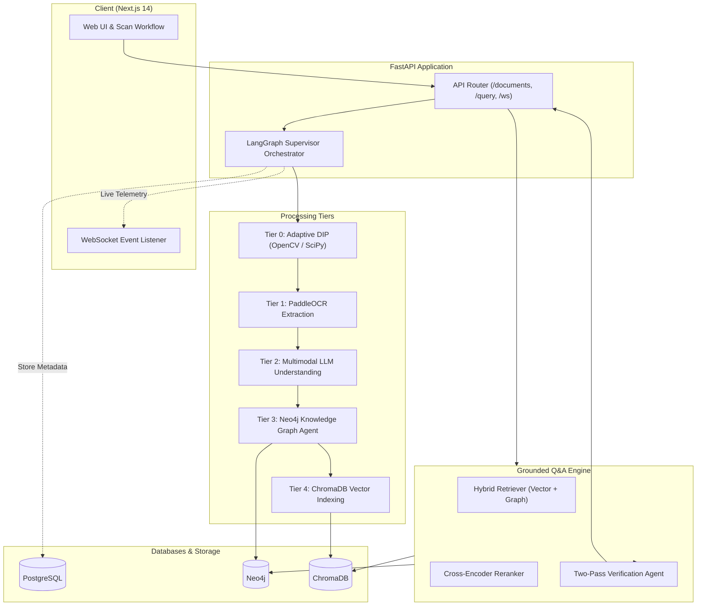

# DocuMind — Intelligent Document Investigator

> **Autonomous Multimodal Document Intelligence, Adaptive DIP Restoration, Knowledge Graph Construction & Hybrid Grounded Q&A.**

**Problem Statement ID:** `ALG-AI-02` (Intelligent Document Investigator)  
**Hackathon:** ALGOTHON'26  
**Team Name:** `[Your Team Name Here]`  
**Team Members:**  
- Member 1: `[Name / GitHub Handle / Email]`  
- Member 2: `[Name / GitHub Handle / Email]`  
- Member 3: `[Name / GitHub Handle / Email]`  

**Live Demo URL:** `[https://documind-demo.placeholder.app]` *(Placeholder)*  
**Demo Video Walkthrough:** `[https://youtu.be/placeholder-demo-video]` *(Placeholder)*  
**GitHub Repository:** [https://github.com/RishitTandon7/DocuMind](https://github.com/RishitTandon7/DocuMind)

---

## 1. Executive Summary & Capabilities

DocuMind is an agentic, multimodal document intelligence system built for investigative analysis over degraded, complex, or multi-page documents. It bridges the gap between low-level computer vision and high-level cognitive understanding:
- **Autonomous Restoration:** Detects document boundaries, dewarps skew via homography, suppresses sensor noise via bilateral filtering, equalizes illumination with CLAHE, and generates sharp output modes (Color, Grayscale, Sauvola B&W).
- **Deep Extraction:** Extracts text with PaddleOCR (bounding polygons + word confidence) and constructs an entity-relationship Knowledge Graph stored in Neo4j.
- **Hybrid Retrieval & Verification:** Employs dense vector embeddings (`BAAI/bge-small-en-v1.5`), cross-encoder reranking (`ms-marco-MiniLM-L-6-v2`), graph traversal, and a two-pass verification agent that scores answer groundedness to eliminate hallucinations.
- **Real-Time Agent Telemetry:** Live streaming of all agent thoughts, decisions, PSNR/SSIM metrics, and processing stages to the frontend via WebSockets.

---

## 2. Mandatory Requirements Compliance Matrix

Below is an honest mapping of DocuMind's features to the mandatory hackathon requirements:

| Requirement | Status | Implementation Details & Gaps |
|---|:---:|---|
| **Multiple document formats (PDF, images, text)** | ⚠️ **PARTIAL** | **Supported:** PDF (multi-page rendering via PyMuPDF), PNG, JPG, JPEG, TIFF, BMP.<br>**Gap:** Plain text files (`.txt`, `.md`) are rejected by extension validation because the pipeline requires visual/image inputs for Tier 0 DIP & OCR. |
| **Extraction / Indexing (OCR + chunking + embeddings / vector DB)** | ✅ **EXISTS** | **Implemented:** PaddleOCR line detection, sliding window chunker (512 words, 64 overlap), BGE-Small dense embeddings (384-dim), ChromaDB vector store, and Neo4j entity graph. |
| **Natural-language Q&A** | ✅ **EXISTS** | **Implemented:** Natural language query endpoint (`/api/v1/query`) powered by hybrid vector search, cross-encoder reranking, and Gemini / Ollama LLM response generation. |
| **Source / section references on every answer (doc name, page, chunk)** | ⚠️ **PARTIAL** | **Supported:** Returns retrieved text snippets, similarity scores, retrieval strategy (`vector` or `graph`), and document ID.<br>**Gap:** Human-readable document filename, page number, and chunk index are not preserved in the chunk metadata or frontend citations. |
| **Conflict detection across documents (show both conflicting sources)** | ❌ **MISSING** | **Gap:** Currently lacks automated cross-document contradiction detection logic and dedicated conflicting-source presentation fields in the response schema. |
| **Uncertainty handling (low-evidence answers say so, with a confidence signal)** | ✅ **EXISTS** | **Implemented:** Grounding verification prompt calibrates confidence between 0.0 and 1.0. If context is empty or unsupported, the system returns an explicit disclaimer with `confidence=0.0`. |

---

## 3. Architecture & Technical Decisions

See [docs/architecture.md](docs/architecture.md) for full architecture specifications and Mermaid diagrams.



### Major Technical Decisions:
1. **DIP Preprocessing First:** Raw documents (especially camera captures) undergo homography dewarping, bilateral filtering, CLAHE contrast tuning, and Sauvola binarization to maximize OCR precision.
2. **PaddleOCR Engine:** Fast, local, accurate optical character recognition with line bounding polygons and confidence scores.
3. **Embeddings & Vector Store:** `BAAI/bge-small-en-v1.5` embeddings (384-dimensional dense vectors) stored in ChromaDB (cosine similarity space).
4. **Chunking Strategy:** Sliding word window of 512 words with 64-word overlap to balance semantic richness and boundary preservation.
5. **Cross-Encoder Reranking:** `cross-encoder/ms-marco-MiniLM-L-6-v2` re-scores retrieved candidates to filter false positives before LLM synthesis.
6. **Two-Pass Verification & Confidence Scoring:** The primary LLM generates a grounded answer; a second zero-temperature verification pass evaluates context support (0.0 to 1.0) and triggers an explicit refusal when evidence is missing.

---

## 4. Setup & Running from a Fresh Clone

### Prerequisites
- Docker & Docker Compose (Recommended) **OR**
- Python 3.11+ and Node.js 18+ (for local manual run)
- Ollama (optional, for local offline LLMs) or Google Gemini API Key

### Option A: Docker Compose (Quickest)

1. **Clone the repository:**
   ```bash
   git clone https://github.com/RishitTandon7/DocuMind.git
   cd DocuMind
   ```

2. **Configure environment:**
   ```bash
   cp .env.example .env
   # Edit .env and enter your GEMINI_API_KEY (or configure Ollama)
   ```

3. **Start all services:**
   ```bash
   docker-compose up --build
   ```

4. **Access the application:**
   - **Frontend UI:** [http://localhost:3000](http://localhost:3000)
   - **Backend API & Swagger Docs:** [http://localhost:8000/docs](http://localhost:8000/docs)
   - **ChromaDB:** [http://localhost:8001](http://localhost:8001)
   - **Neo4j Browser:** [http://localhost:7474](http://localhost:7474)

---

### Option B: Local Development (Without Docker)

#### 1. Backend Setup:
```bash
# Navigate to backend and create virtual environment
cd backend
python -m venv .venv
# On Windows:
.venv\Scripts\activate
# On Linux/macOS:
# source .venv/bin/activate

# Install dependencies
pip install -r ../requirements.txt

# Start PostgreSQL, Neo4j, and ChromaDB locally or via docker:
# docker run -d -p 5432:5432 -e POSTGRES_PASSWORD=documind -e POSTGRES_USER=documind -e POSTGRES_DB=documind postgres:15
# docker run -d -p 7687:7687 -p 7474:7474 -e NEO4J_AUTH=neo4j/documind_neo4j neo4j:5.18
# chroma run --host localhost --port 8001

# Copy environment config
cp ../.env.example .env

# Launch FastAPI backend
uvicorn main:app --host 0.0.0.0 --port 8000 --reload
```

#### 2. Frontend Setup:
```bash
cd frontend
npm install
npm run dev
# Accessible at http://localhost:3000
```

---

## 5. Environment Variables

| Variable | Description | Default / Example |
|---|---|---|
| `APP_NAME` | Name of the application | `DocuMind` |
| `API_V1_PREFIX` | Base route prefix for API endpoints | `/api/v1` |
| `CORS_ALLOWED_ORIGINS` | Comma-delimited list of allowed frontend origins | `http://localhost:3000` |
| `POSTGRES_HOST` | PostgreSQL hostname | `localhost` / `postgres` |
| `POSTGRES_PORT` | PostgreSQL port | `5432` |
| `POSTGRES_USER` | PostgreSQL username | `documind` |
| `POSTGRES_PASSWORD` | PostgreSQL password | `documind` |
| `POSTGRES_DB` | PostgreSQL database name | `documind` |
| `NEO4J_URI` | Neo4j Bolt connection URI | `bolt://localhost:7687` |
| `NEO4J_USER` | Neo4j username | `neo4j` |
| `NEO4J_PASSWORD` | Neo4j password | `documind_neo4j` |
| `CHROMA_HOST` | ChromaDB vector store host | `localhost` / `chromadb` |
| `CHROMA_PORT` | ChromaDB vector store port | `8001` |
| `CHROMA_COLLECTION_NAME`| ChromaDB collection for chunk embeddings | `documind_chunks` |
| `LLM_PROVIDER` | LLM backend (`gemini` or `ollama`) | `gemini` |
| `GEMINI_API_KEY` | Google Gemini API Key | `your_gemini_api_key_here` |
| `GEMINI_MODEL_NAME` | Gemini model name | `gemini-1.5-flash` |
| `OLLAMA_BASE_URL` | Local Ollama endpoint | `http://localhost:11434` |
| `OLLAMA_TEXT_MODEL` | Text generation model for Ollama | `llama3.2` |
| `OLLAMA_VISION_MODEL` | Multimodal model for Ollama | `qwen3-vl:4b` |
| `EMBEDDING_MODEL_NAME` | Dense sentence embedding model | `BAAI/bge-small-en-v1.5` |
| `RERANKER_MODEL_NAME` | Cross-encoder reranker model | `cross-encoder/ms-marco-MiniLM-L-6-v2` |
| `CHUNK_SIZE` | Chunk size in words | `512` |
| `CHUNK_OVERLAP` | Overlap size in words | `64` |
| `MAX_UPLOAD_SIZE_MB` | Maximum allowed file upload size | `25` |
| `NEXT_PUBLIC_API_BASE_URL`| API URL accessed by frontend | `http://localhost:8000` |
| `NEXT_PUBLIC_WS_BASE_URL` | WebSocket URL for agent streaming | `ws://localhost:8000` |

---

## 6. How to Demo

Detailed walkthrough questions and expected responses are documented in [sample_docs/DEMO_QUESTIONS.md](sample_docs/DEMO_QUESTIONS.md).

### Quick Demo Steps:
1. Open the web interface at `http://localhost:3000`.
2. Upload a sample document from `/sample_docs/`:
   - `company_policy_2024.pdf`: Observe the multi-page image rendering, DIP restoration (dewarp, CLAHE, B&W conversion), and PaddleOCR extraction.
   - `quarterly_invoice.png`: Inspect the real-time agent activity panel as it extracts key-value items into the Knowledge Graph.
3. Switch to the **Ask / Query** view:
   - **Fact Extraction:** Ask *"Who is the Principal Systems Architect for Project Titan and what is the budget?"* (Answers Dr. Elena Rostova and $250k with high confidence).
   - **Uncertainty / Refusal:** Ask *"What is the policy for employee international relocation visa reimbursements?"* (Answers with an explicit refusal that no evidence was found, confidence `0.0`).
   - **Contradiction Test:** Ask *"What is the maximum daily meal allowance for domestic business travel?"* after uploading both `company_policy_2024.pdf` ($75) and `travel_update_memo_2025.txt` ($120).

---

## 7. Testing & Verification

Automated test suites covering format ingestion, citations, conflict detection, uncertainty handling, and edge cases are located in `/tests`.

To run the full suite:
```bash
python tests/run_tests.py
```

Detailed test logs and edge case validation results are documented in [TESTING.md](TESTING.md).

---

## 8. Known Limitations & Future Improvements

We believe in radical engineering honesty:

1. **Plain Text Direct Ingestion:**  
   *Current State:* The backend pipeline expects image arrays for DIP and OCR, causing `.txt` files to be rejected.  
   *Improvement:* Add a direct-to-chunking text ingestion route that bypasses DIP/OCR for raw text files.
2. **Granular Citations in Query Responses:**  
   *Current State:* ChromaDB stores `document_id` and text content, but omits filename, page number, and chunk index from the metadata payload.  
   *Improvement:* Persist `filename`, `page_number`, and `chunk_index` in Chroma metadata and render interactive citation badges in the frontend.
3. **Cross-Document Conflict Detection Engine:**  
   *Current State:* Conflicting statements across documents are blended or ranked by relevance rather than flagged as contradictory.  
   *Improvement:* Implement an NLI (Natural Language Inference) cross-document contradiction check during multi-document retrieval to highlight opposing claims side-by-side.
4. **Tabular Data Structure Preservation:**  
   *Current State:* Tables are extracted as serialized OCR text lines, which can degrade column alignment in complex multi-column spreadsheets.

---

## 9. Disclosures & Attributions

- **External APIs & Services:** Google Gemini API (`gemini-1.5-flash`) for multimodal document understanding and grounded Q&A.
- **Open-Source Pretrained Models:**
  - `BAAI/bge-small-en-v1.5` (Embedding model via HuggingFace Sentence-Transformers)
  - `cross-encoder/ms-marco-MiniLM-L-6-v2` (Cross-encoder reranker)
  - `PaddleOCR` (Optical Character Recognition)
- **Open-Source Databases:** PostgreSQL 15, Neo4j Community 5.18, ChromaDB.
- **Datasets:** Synthetic demonstration documents created for evaluation (located in `/sample_docs`).
- **AI-Assisted Development:** In accordance with hackathon guidelines, AI coding assistants (including Antigravity / Gemini) were utilized to assist in writing test harnesses, documentation, sample data generation, and repository auditing.
