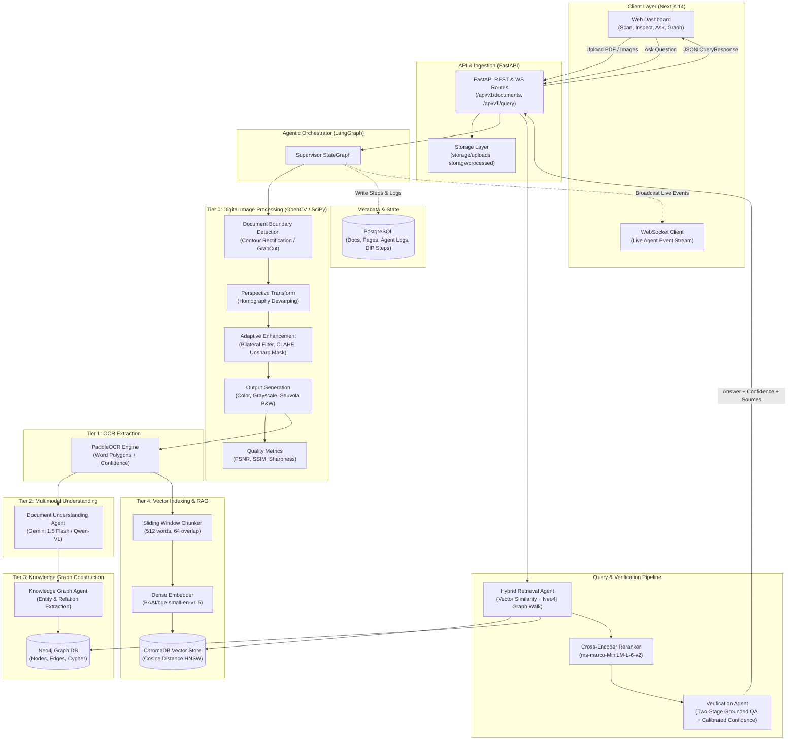

# DocuMind System Architecture

## Architecture Diagram

---

## Technical Decisions & Rationale

### 1. Document Preprocessing & Adaptive DIP (OpenCV)
- **Decision:** Multi-stage image restoration pipeline prior to OCR instead of passing raw scans straight to optical recognition.
- **Components:** Quadrilateral boundary detection, 4-point perspective warp, adaptive bilateral smoothing, CLAHE contrast equalization, unsharp masking, and tri-modal output rendering (Color, Grayscale, Sauvola B&W).
- **Rationale:** Mobile scans and degraded PDFs suffer from uneven shadows, geometric skew, and low contrast. Preprocessing significantly increases downstream OCR character accuracy and structural preservation.

### 2. OCR Engine (PaddleOCR)
- **Decision:** PaddleOCR with line/polygon bounding boxes and confidence thresholds.
- **Rationale:** High accuracy on receipts, tabular forms, and degraded scans with minimal latency compared to heavy cloud vision APIs.

### 3. Embeddings & Vector Database (BGE-Small + ChromaDB)
- **Decision:** `BAAI/bge-small-en-v1.5` embeddings (384 dimensions) indexed in ChromaDB with cosine similarity.
- **Rationale:** Lightweight, high MTEB benchmark score for semantic text retrieval, and simple local/embedded deployment without external cloud vector SaaS overhead.

### 4. Knowledge Graph (Neo4j)
- **Decision:** Property graph storing extracted domain entities (organizations, people, dates, monetary amounts) and relationships.
- **Rationale:** Complements vector similarity with multi-hop relational lookups (e.g., finding the vendor associated with an invoice tied to a specific project).

### 5. Chunking Strategy (Sliding Word Window)
- **Decision:** 512-word windows with 64-word overlaps.
- **Rationale:** Prevents context splitting across boundary sentences while fitting within the optimal context window of the cross-encoder reranker.

### 6. Reranking (Cross-Encoder ms-marco-MiniLM-L-6-v2)
- **Decision:** Two-stage retrieval: top-10 candidates from ChromaDB are scored by a cross-encoder to select top-5.
- **Rationale:** Dense vector search provides high recall, while cross-attention between question and passage dramatically improves precision.

### 7. Uncertainty Handling & Two-Pass Verification
- **Decision:** Prompt-level hallucination guardrails combined with a calibrated verification pass.
- **Rationale:** Single-pass LLM generation frequently suffers from overconfidence. The verification pass asks the model to rate factual support on a 0.0 to 1.0 scale and falls back to an explicit refusal with confidence `0.0` when no relevant evidence exists.
